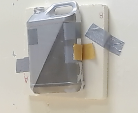
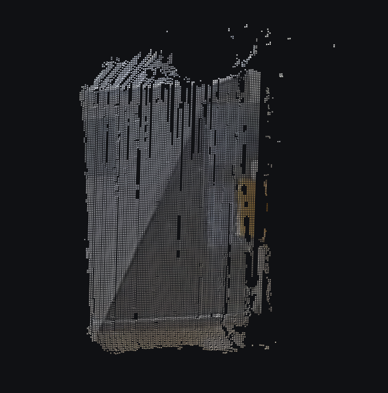
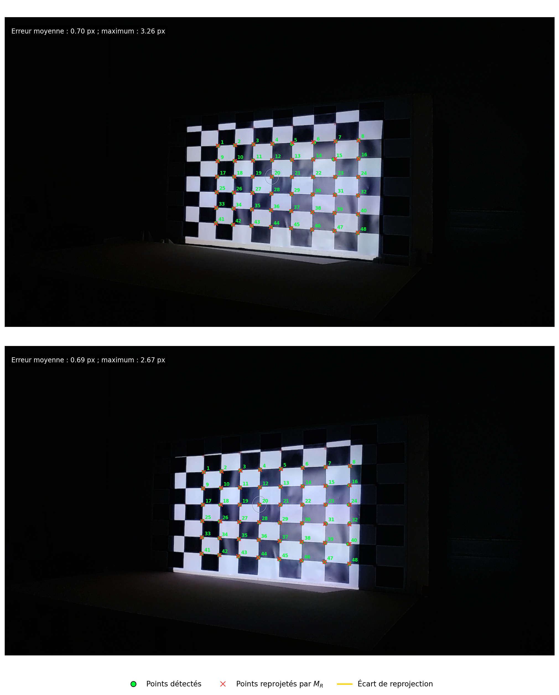

# Structured-Light 3D Scanner

Prototype de scanner 3D par lumière structurée binaire. L'interface Windows Forms (C#) pilote le couple caméra-projecteur. Le pipeline Python et OpenCV exploite la calibration et les images de franges pour calculer un nuage de points et lui associer les couleurs d'une photo de l'objet.

**[Explorer la galerie interactive](https://math680.github.io/structured-light-3d-gallery/)** : ouvrez une reconstruction pour voir le résultat sans installer le logiciel ni disposer du matériel.

## De la capture au nuage de points

1. Calibrer la caméra et le projecteur.
2. Projeter les franges binaires et acquérir une séquence d'images.
3. Décoder les correspondances et reconstruire les points 3D.
4. Exporter les points et leur couleur dans une vue HTML interactive.

## Aperçu

Exemple de reconstruction couleur sur le bidon gris :





Validation de reprojection pendant la calibration :



## Organisation du dépôt

```text
.
├── UI/                          Interface Windows Forms C#
├── reconstruction/              Pipeline Python fonctionnel
│   ├── src/reconstruction3d/     Code Python principal
│   ├── scripts/                 Lanceurs reconstruction
│   ├── scripts_calibration/     Calibration caméra/projecteur
│   ├── scripts_projection/      Projection plein écran
│   └── calibration_validee/     Calibration validée MR/ME
├── tools/creer_masque.py        Outil interactif de création de masque
└── assets/readme/               Images de présentation du projet
```

## Prérequis

- Windows
- Python 3.7 ou plus récent
- Packages Python : `numpy`, `opencv-python`
- Visual Studio 2019/2022 avec MSBuild et .NET Framework 4.8
- NuGet pour restaurer les dépendances de l'interface

Installation Python minimale :

```powershell
python -m pip install -r requirements.txt
```

## Interface graphique

Restaurer les packages NuGet puis compiler :

```powershell
$solution = (Get-ChildItem -Path UI -Filter *.sln -Recurse -File).FullName
nuget restore $solution
msbuild $solution /p:Configuration=Debug /p:Platform="Any CPU"
```

L'exécutable généré se trouve dans le dossier `bin/Debug/` du projet Windows Forms :

```powershell
Get-ChildItem -Path UI -Filter *.exe -Recurse -File |
  Where-Object { $_.DirectoryName -like '*\bin\Debug' }
```

Depuis l'UI, les captures sont copiées dans `reconstruction/captures/captures`.
La calibration lance l'outil de masque puis
`reconstruction/scripts_calibration/ajuster_points_calibration.py`.
L'acquisition lance ensuite le masque objet puis
`reconstruction/scripts/lancer_reconstruction.py --objets "1" --ouvrir-html`.

## Utilisation du pipeline Python

Créer ou modifier un masque :

```powershell
python tools\creer_masque.py --folder "reconstruction\captures\captures\1"
```

Lancer une reconstruction :

```powershell
cd reconstruction
python scripts\lancer_reconstruction.py --objets "1" --ouvrir-html
```

Les résultats sont écrits dans :

```text
reconstruction/resultats/<nom_objet>/
```

Fichiers principaux produits :

- `vue_3d_interactive.html` : visualisation 3D dans le navigateur
- `points_3d_repere_plan.txt` : points 3D dans le repère du plan
- `points_3d_brut.txt` : points 3D avant changement de repère
- `couleurs_rgb.txt` : couleurs associées aux points si `capture_couleur.png`
  est disponible

## Données générées

Les dossiers suivants sont volontairement ignorés par Git :

- `reconstruction/captures/`
- `reconstruction/resultats/`
- `UI/**/bin/`
- `UI/**/obj/`

Ils peuvent être recréés par l'interface ou par les scripts Python.
